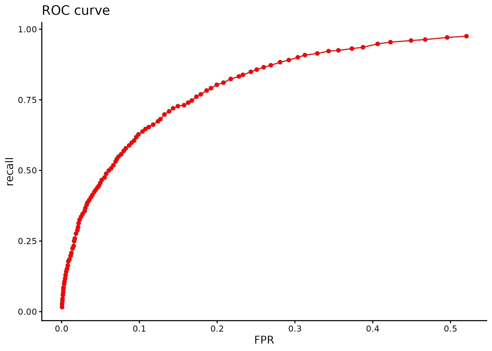
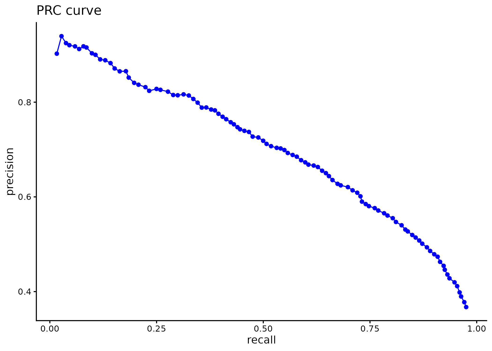

# m6APrediction

m6APrediction predicts m6A probabilities and statuses for one site or a table of sites using the random forest model supplied in BIO215 Practical 6.

## Installation

Requires R >= 3.5.0. The package imports randomForest and stats.

Install from GitHub:

```r
remotes::install_github("Runlin-Xu/m6APrediction")
```

Alternatively, download `m6APrediction_1.0.0.tar.gz`, set your working directory to its folder, and run:

```r
install.packages("m6APrediction_1.0.0.tar.gz", repos = NULL, type = "source")
```

## Multiple-site prediction

```r
library(m6APrediction)
ml_fit <- readRDS(system.file("extdata", "rf_fit.rds",
                            package = "m6APrediction", mustWork = TRUE))
feature_df <- read.csv(system.file("extdata", "m6A_input_example.csv",
                                 package = "m6APrediction", mustWork = TRUE))
prediction_multiple(ml_fit, feature_df[1:3, ], positive_threshold = 0.6)
```

The returned table adds `predicted_m6A_prob` and `predicted_m6A_status`. The example scores for its first three rows are 0.876, 0.000 and 0.498, with statuses Positive, Negative and Negative.

## Single-site prediction

```r
library(m6APrediction)
ml_fit <- readRDS(system.file("extdata", "rf_fit.rds",
                            package = "m6APrediction", mustWork = TRUE))
prediction_single(ml_fit, gc_content = 0.6, RNA_type = "mRNA",
                  RNA_region = "CDS", exon_length = 12,
                  distance_to_junction = 5, evolutionary_conservation = 0.8,
                  DNA_5mer = "GGACA", positive_threshold = 0.5)
```

This returns a named character vector: `predicted_m6A_prob` is "0.51" and `predicted_m6A_status` is "Positive" for this example.

## Inputs and interpretation

The seven input features are `gc_content`, `RNA_type`, `RNA_region`, `exon_length`, `distance_to_junction`, `evolutionary_conservation` and `DNA_5mer`. Use the feature scales shown in the supplied example data; exon length and junction distance are already log2-transformed. DNA contexts have five bases with A at the centre.

A score strictly greater than `positive_threshold` is Positive; equality is Negative. These examples demonstrate software use with teaching data. They do not establish performance on new species or independent biological data.

## Model performance illustration





These figures reproduce Practical3_Assignment Task 2 using its imbalanced teaching data, an 80% training / 20% test split, seed 123 and thresholds from 0.05 to 0.95. The ROC plot shows recall against false-positive rate; the PRC plot shows precision against recall. They illustrate the earlier teaching classifier and are not an independent validation of the model bundled in Practical 6.

## License

MIT license. See `LICENSE` for the year and copyright holder.
